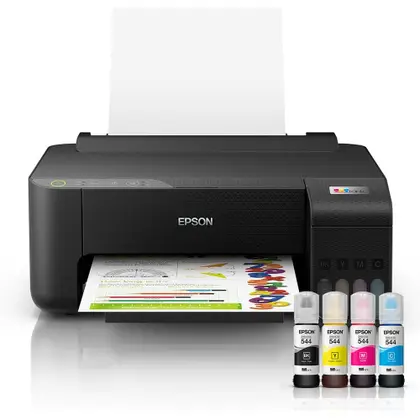

# Como construir a página da Assistech

Este guia explica, em ordem, como o site foi construído até o estado atual. A ideia é que você consiga repetir o projeto em uma pasta nova e entender o papel de cada arquivo.

## 1. Criar a pasta do projeto

Crie uma pasta para o site e abra essa pasta no VS Code.

Estrutura inicial:

```text
projeto-teste-html/
└── index.html
```

No PowerShell:

```powershell
mkdir projeto-teste-html
cd projeto-teste-html
code .
```

## 2. Criar a estrutura HTML

O arquivo `index.html` é a página principal. Ele contém:

- `header`: logo e menu de navegação
- `main`: conteúdo principal
- `section`: blocos de início, apresentação, serviços e contato
- `footer`: rodapé

Comece com a estrutura básica:

```html
<!DOCTYPE html>
<html lang="pt-BR">
<head>
  <meta charset="UTF-8">
  <meta name="viewport" content="width=device-width, initial-scale=1.0">
  <link rel="stylesheet" href="style.css">
  <title>Assistech</title>
</head>
<body>
  <header>
    <a href="#inicio">Assistech</a>
  </header>

  <main>
    <section id="inicio">
      <h1>Assistência técnica especializada</h1>
    </section>
  </main>
</body>
</html>
```

O atributo `viewport` é essencial para o site se adaptar a celulares, tablets e computadores.

## 3. Adicionar as seções da página

Depois da estrutura inicial, foram adicionadas as seções:

```html
<section id="inicio">
  <h1>Assistência técnica que cuida do que é importante para você.</h1>
  <a href="#contato">Solicitar atendimento</a>
</section>

<section id="sobre">
  <h2>Sobre a Assistech</h2>
  <p>Descrição da empresa e dos serviços oferecidos.</p>
</section>

<section id="servicos">
  <h2>Serviços especializados</h2>
  <div class="cards">
    <article class="card">
      
      <h3>Manutenção de notebooks</h3>
      <p>Reparo e otimização de notebooks.</p>
    </article>
  </div>
</section>

<section id="contato">
  <h2>Entre em contato</h2>
  <form id="form-contato">
    <input name="nome" type="text" required>
    <input name="email" type="email" required>
    <textarea name="mensagem" required></textarea>
    <button type="submit">Enviar mensagem</button>
  </form>
</section>
```

Os links do menu usam os mesmos valores dos atributos `id`. Por exemplo, `href="#servicos"` leva até `id="servicos"`.

## 4. Organizar as imagens

As imagens devem ficar em uma pasta própria:

```text
imagens/
├── celular.jpg
├── impressora.jpg
├── jbl_.jpg
├── microondas.jpg
├── nobreak_.jpg
└── notebook.jpg
```

No HTML, use caminhos relativos:

```html

```

O texto do `alt` descreve a imagem para acessibilidade e também aparece quando a imagem não carrega.

## 5. Criar o CSS responsivo

O arquivo `style.css` controla aparência, espaçamento, cores e adaptação para diferentes telas.

A base usada no projeto foi:

```css
:root {
  --cor-principal: #2563eb;
  --cor-escura: #172033;
  --cor-fundo: #f5f7fb;
  --cor-texto: #334155;
  --cor-branca: #ffffff;
}

* {
  box-sizing: border-box;
  margin: 0;
  padding: 0;
}

body {
  background: var(--cor-fundo);
  color: var(--cor-texto);
  font-family: Arial, sans-serif;
  line-height: 1.6;
}

.container {
  margin: 0 auto;
  max-width: 1120px;
  padding: 0 24px;
  width: 100%;
}
```

As variáveis em `:root` evitam repetir as mesmas cores pelo arquivo.

Para os cards, use CSS Grid:

```css
.cards {
  display: grid;
  gap: 20px;
  grid-template-columns: repeat(auto-fit, minmax(min(100%, 240px), 1fr));
}
```

Essa regra cria colunas automaticamente e evita que os cards ultrapassem a tela.

## 6. Criar o menu hambúrguer

No HTML, o botão fica ao lado da logo:

```html
<button class="menu-toggle" type="button"
  aria-expanded="false" aria-controls="menu-principal">
  <span class="menu-icon" aria-hidden="true"></span>
  <span class="menu-label">Abrir menu</span>
</button>
```

O atributo `aria-expanded` informa se o menu está aberto. O `aria-controls` indica qual elemento será controlado.

O menu aparece no formato hambúrguer em telas abaixo de `1100px`:

```css
.menu-toggle {
  display: none;
}

@media (max-width: 1100px) {
  .menu-toggle {
    display: inline-flex;
    margin-left: auto;
  }

  .site-nav {
    display: none;
    width: 100%;
  }

  .site-nav.is-open {
    display: block;
  }
}
```

## 7. Programar o menu no JavaScript

O arquivo `intecaopg.js` adiciona comportamento à página. Ele abre e fecha o menu, fecha ao clicar em um link e permite fechar com `Escape`.

A página carrega o arquivo no `<head>`:

```html
<script src="intecaopg.js" defer></script>
```

O `defer` faz o navegador carregar o JavaScript sem bloquear o HTML.

A lógica principal é:

```javascript
const menuButton = document.querySelector('.menu-toggle');
const menu = document.querySelector('#menu-principal');

menuButton.addEventListener('click', () => {
  const isOpen = menu.classList.toggle('is-open');
  menuButton.setAttribute('aria-expanded', String(isOpen));
});
```

Quando `aria-expanded="true"`, o CSS transforma as linhas do hambúrguer em um X discreto.

## 8. Criar o formulário de contato

O formulário precisa de nomes nos campos para que a API consiga identificar os dados:

```html
<form id="form-contato">
  <label for="nome">Nome</label>
  <input id="nome" name="nome" type="text" required>

  <label for="email">E-mail</label>
  <input id="email" name="email" type="email" required>

  <label for="mensagem">Mensagem</label>
  <textarea id="mensagem" name="mensagem" required></textarea>

  <button type="submit">Enviar mensagem</button>
  <p id="form-status" role="status" aria-live="polite" hidden></p>
</form>
```

O `required` impede o envio de campos vazios. O elemento `form-status` mostra mensagens como “Enviando mensagem...” e “Mensagem enviada com sucesso!”.

## 9. Criar o projeto Node.js

Para transformar o site em uma aplicação com envio real, inicialize o Node.js:

```powershell
npm init -y
npm install express nodemailer dotenv
```

Os pacotes usados são:

- `express`: cria o servidor e a rota da API
- `nodemailer`: envia e-mails usando SMTP
- `dotenv`: lê configurações do arquivo `.env`

O arquivo `package.json` possui o comando:

```json
"scripts": {
  "start": "node server.js"
}
```

## 10. Configurar o ambiente SMTP

Crie o arquivo `.env` na raiz do projeto. Ele não deve ser publicado nem enviado ao GitHub.

Use `.env.example` como modelo:

```env
PORT=3000
SMTP_HOST=smtp.gmail.com
SMTP_PORT=465
SMTP_SECURE=true
SMTP_USER=seu-email@gmail.com
SMTP_PASS="sua-senha-de-aplicativo"
DESTINATION_EMAIL=destino@example.com
```

A senha deve ser uma **senha de aplicativo do Google**, não a senha normal do Gmail. O caractere `#` precisa ficar dentro de aspas porque, no arquivo `.env`, ele pode iniciar um comentário.

O `.gitignore` impede o envio acidental do `.env`:

```text
.env
node_modules/
```

## 11. Criar a API em `server.js`

A API recebe os dados em `POST /api/contato`, valida os campos e usa o Nodemailer para enviar a mensagem:

```javascript
app.post('/api/contato', async (req, res) => {
  const { nome, email, mensagem } = req.body;

  if (!nome || !email || !mensagem) {
    return res.status(400).json({
      error: 'Preencha nome, e-mail e mensagem.',
    });
  }

  try {
    await transporter.sendMail({
      from: `Assistech - Site <${process.env.SMTP_USER}>`,
      to: process.env.DESTINATION_EMAIL,
      replyTo: email,
      subject: `Novo atendimento para a Assistech - ${nome}`,
      text: `Cliente: ${nome}\nE-mail: ${email}\n\nMensagem:\n${mensagem}`,
    });

    return res.json({ message: 'Mensagem enviada com sucesso!' });
  } catch {
    return res.status(500).json({
      error: 'Não foi possível enviar a mensagem agora.',
    });
  }
});
```

No projeto atual, o servidor também limita o tamanho dos campos, valida o formato do e-mail e retorna uma explicação quando o SMTP não está configurado.

## 12. Conectar o formulário à API

Em vez de usar `mailto:`, o JavaScript envia os dados para o servidor:

```javascript
const response = await fetch('/api/contato', {
  method: 'POST',
  headers: {
    'Content-Type': 'application/json',
  },
  body: JSON.stringify({
    nome: formData.get('nome'),
    email: formData.get('email'),
    mensagem: formData.get('mensagem'),
  }),
});
```

A resposta é lida com segurança como texto e convertida para JSON somente quando existe conteúdo. Isso evita o erro `Unexpected end of JSON input`.

## 13. Executar o site

Na pasta do projeto:

```powershell
npm install
npm start
```

Abra no navegador:

```text
http://localhost:3000
```

Não abra o arquivo diretamente nem use apenas o Live Server para testar o formulário, porque nesses casos a rota `/api/contato` não estará disponível.

## 14. Testar a API

Você pode testar a validação da rota pelo PowerShell:

```powershell
Invoke-WebRequest `
  -Uri http://localhost:3000/api/contato `
  -Method Post `
  -ContentType 'application/json' `
  -Body '{"nome":"Teste","email":"teste@example.com","mensagem":"Mensagem de teste"}'
```

Se o SMTP estiver configurado corretamente, a API deverá retornar:

```json
{
  "message": "Mensagem enviada com sucesso!"
}
```

## 15. Verificar erros de sintaxe

Antes de usar os arquivos JavaScript, execute:

```powershell
node --check .\server.js
node --check .\intecaopg.js
```

Se não aparecer nenhuma mensagem, a sintaxe dos arquivos está correta.

## 16. Estrutura final do projeto

```text
projeto-teste-html/
├── imagens/
├── .env
├── .env.example
├── .gitignore
├── index.html
├── intecaopg.js
├── package.json
├── package-lock.json
├── README.md
├── server.js
├── style.css
└── GUIA-PASSO-A-PASSO.md
```

## O que estudar em seguida

1. HTML semântico: `header`, `main`, `section`, `article` e `form`.
2. CSS Grid, Flexbox e media queries.
3. JavaScript com eventos, `fetch`, `async` e `await`.
4. Node.js e Express para criar APIs.
5. Variáveis de ambiente e segurança de credenciais.
6. SMTP, Nodemailer e validação de formulários.
7. Publicação do frontend e backend em um serviço de hospedagem.

Nunca publique o arquivo `.env` e nunca coloque senhas SMTP no HTML ou no JavaScript do navegador.
